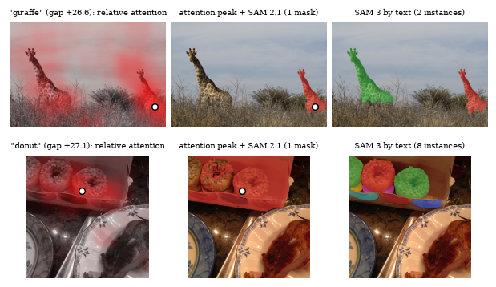
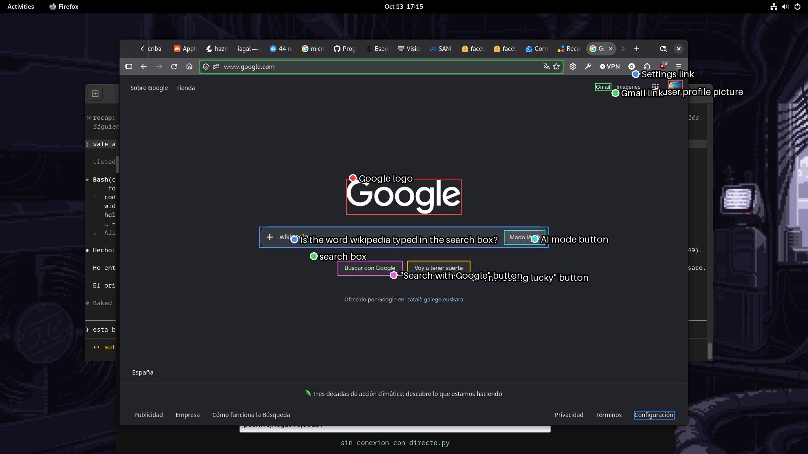
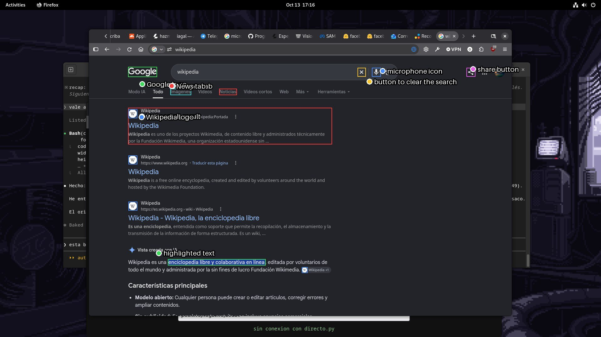

# YOLOJ

Where a vision-language model looks when it answers yes or no — and whether
that is enough to make a detector out of a question. No detection head, no
label set, nothing trained.



*Left: the model is asked "is there a giraffe?" and five of its attention heads
say where. Centre: that point handed to SAM 2.1. Right: SAM 3 given only the
word. Two held-out COCO images picked to show several instances.*

A *semantic if* reads a yes/no decision out of a model's logits in one forward
pass (JEV, see [discern](https://github.com/XxSamaxX/discern)). YOLOJ asks
whether the same pass can also say *where*, for a predicate written at run
time. Everything runs on one RTX 3080 with 12 GB.

**Paper:** [paper/paper.pdf](paper/paper.pdf) — the full account, with the
figures and the limits of each number.

## What came out

Qwen3-VL-4B, 400 COCO val2017 images: every choice made on 200, every number
below measured on the other 200. 13 October 2026.

| Question | Answer |
|---|---|
| Does the model know where the thing is? | Yes. Five attention heads hit the object on **78.5 %** of images (chance 10.6 %, image centre 29.0 %) |
| Does it know whether it is there? | Yes. Logit gap, present vs absent category: AUC **0.996** |
| What does one more question on the same image cost? | **12–17 ms**; all 80 COCO classes in 1.2 s |
| Can the point be turned into a good mask? | Not competitively. Point + SAM: **54.5–59.5 %** of boxes with IoU ≥ 0.5 |
| What does SAM 3 do with just the word, no language model? | **85.0 %**, and it finds 83 % of individual instances against 35 % |
| So what is the language model for? | Judging. States, relations, reading — where SAM 3's score does not follow the state (one photo, not a benchmark) |

In short: for anything that has a name, SAM 3 by text is the better localiser.
What is left for the language model is deciding whether a condition holds, and
pointing at conditions that have no name. The second half of that sentence is
the part that is not measured yet.

## Inside the 4B: where the answer is made

`experimentos/desgrane.py` runs Qwen3-VL-4B once per (image, predicate) in
transformers and keeps every layer's attention and hidden state. First pass,
five cases on three COCO images, 13 October 2026. Read by eye; the heads below
were picked on two of the same images they are shown on, so this is a lead, not
a result.

- **The answer appears at layer 24 of 36.** Reading the yes/no gap from each
  layer's hidden state gives noise (+0.5 to +3, always leaning to `A`) up to
  layer 23, then ±7 to ±9 with the right sign at layer 24 in all five cases, and
  ±19 to ±22 at the last layer.
- **The model looks at the image in layers 17 to 23**, just before deciding.
- **A sink token eats the late attention.** From layer 18 on, 65–78 % of the
  attention to the image goes to one patch that does not change with the
  question. Averaging heads shows only that patch.
- **A few heads in layers 20–21 point at the object.** Heads 20.15, 21.31, 21.8
  and 21.25 put 25–51 % of their image attention inside the remote controls
  (6 % of the grid) and 49–76 % inside the television (8 %).
- **Their attention mass drops when the object is absent**: 0.21 / 0.21 for
  "remote", 0.02 / 0.08 for "dog" on the same photo.
- **Attention is nearly free**: 126 ms per forward without it, 123–169 ms with
  every layer's attention returned. 8.3 GiB of VRAM in bf16.


*Rows: remote, cat, dog (absent), television, racket. Columns: the four heads
and their sum. The dot on the cat's back in the right-hand columns is the sink.*

## COCO: do the heads hold up on images they were not picked on?

400 COCO val2017 images, one present and one absent category each
(`experimentos/coco_atencion.py`). Heads are chosen on the first 200 and
measured on the other 200 (`experimentos/coco_cabezas.py`), against the real
segmentation mask on the 32-pixel token grid. Objects cover 0.5–30 % of the
image. 13 October 2026.

**Pointing game** — does the peak of the map land on the object? Held-out half:

| Map | Hit rate | AUC |
|---|---|---|
| Chance (object area) | 10.6 % | 0.500 |
| Centre of the image | 29.0 % | 0.650 |
| Mean of all 1,152 heads, raw | 1.5 % | 0.648 |
| Head 20.15 alone, raw | 59.5 % | 0.837 |
| Head 20.15 alone, relative | 71.5 % | 0.880 |
| **5 chosen heads, relative** | **78.5 %** | **0.892** |

"Relative" divides each head's map by the same head's map for a content-free
question on the same image. That removes the sink better than masking the three
most-attended cells (59–64 %). It costs one extra forward per image, shared by
every predicate asked about it.

The best heads are all in layers 20–22. Head 20.15, spotted by eye on two
photos in the first pass, is also the best one on 198 images.

**Presence** — same image, object asked about present vs absent:

| Signal | AUC |
|---|---|
| Logit gap, last layer | 0.996 |
| Attention mass of 3 chosen heads | 0.992 |

**Early exit** — the gap read at each layer: chance up to layer 21, 96.5 % sign
accuracy at layer 24, and 96.5 % at layer 35. Layers 25–35 sharpen the gap (AUC
0.969 → 0.996) without changing which side it falls on.

Limits: absent categories are random, so they are easy negatives; the pointing
game accepts any cell at least a quarter covered; one category per image, and
several instances count as one target. This is not a detection benchmark yet.

## From attention to a mask: SAM 2.1 prompted by the peak

The attention map says where, not how far the object extends: thresholded on
its own it reaches a mask IoU of 0.36 on the held-out half, and 42 % of its
boxes overlap the real one by half or more (`experimentos/coco_mascara.py`).
Each cell is 32 px wide, so it is a blob by construction.

`experimentos/coco_sam.py` hands the peak of the map to SAM 2.1 as a point and
keeps, of SAM's three candidate masks, the one that best matches the thresholded
map. Pixel-level, against the real COCO mask, same 200 held-out images:

| | Mask IoU | Boxes with IoU ≥ 0.5 | one instance / several |
|---|---|---|---|
| Attention alone (grid resolution) | 0.36 | 42 % | 39 % / 48 % |
| + SAM 2.1 small, 1 point | 0.53 | 54.5 % | 69 % / 24 % |
| + SAM 2.1 large, 1 point | 0.55 | 58.0 % | 74 % / 26 % |
| Ceiling: best of SAM's 3 masks (large) | 0.62 | 67.5 % | 85 % / 32 % |

Picking the candidate by agreement with the map beats picking SAM's own top
score (58.0 % against 48.5 %, large). A box from the map plus the point helps
when there are several instances (42 %) and hurts when there is one.

Everything fits on a 12 GB card, and SAM is the cheap part:

| Stage | SAM small | SAM large |
|---|---|---|
| Predicate forward (4B) | 128 ms | 129 ms |
| Content-free forward (4B), once per image | 131 ms | 131 ms |
| SAM, encode + one prompt | 22 ms | 73 ms |
| **Total, image + first predicate** | **281 ms** | **333 ms** |
| Each further predicate on the same image | 151 ms | 202 ms |
| Peak VRAM, both models | 9.0 GiB | 9.3 GiB |

Weak spots: several instances (one point gives one mask, the target is their
union), objects under 3 % of the image (31–32 % of boxes), and the 21.5 % of
images where the peak is off the object to begin with.

## The image once, the questions in a batch

Every question about an image shares the start of the prompt: system message
plus image, 338 of ~385 tokens. `experimentos/prefijo.py` runs that prefix once,
keeps its key/value cache, and feeds the questions as a batch of ~45-token
suffixes on top of it.

Same answers as the plain forward, on 30 images × 3 questions: the gap moves by
0.26 nats on average (1.0 at most, on gaps of ±20), the sign matches 90 / 90,
and the head maps correlate at 0.99 on average (0.83 at worst).

| | Plain forwards | Shared prefix |
|---|---|---|
| Image + predicate + content-free question | 259 ms | 133 + 34 = 167 ms |
| Each further predicate on the same image | 128 ms | 12–17 ms |
| All 80 COCO classes on one image | ~10.5 s | 133 ms + 1.1 s |

The 133 ms of the prefix are 49 ms of vision encoder and 85 ms of language
model; preparing the image on the CPU takes 2 ms. At 448×336 the whole forward
drops to 83 ms (140 image tokens), at 320×240 to 55 ms (80 tokens); accuracy at
those sizes is not measured.

The times are per stage, measured separately; the full chain with SAM has not
been re-timed end to end with the shared prefix.

## One mask per peak: no gain

`experimentos/coco_instancias.py` passes each peak of the map to SAM as its own
object and joins the masks, with the number of peaks and their threshold chosen
on the first half. On the held-out half it helps images with several instances
(24 % → 30 % of boxes with IoU ≥ 0.5) and hurts those with one (70 % → 66 %):
54.5 % overall against 55.0 % for a single peak. The +8 points it showed on the
tuning half did not carry over.

## 16 or 32 bits, and SAM 3 by point

Ragged mask borders looked like a half-precision artefact. They are not
(`experimentos/coco_sam.py --fp32`): same quality, 2.6–2.9 times slower.

| Segmenter, 1 point | Mask IoU | Boxes ≥ 0.5 | one / several | ms |
|---|---|---|---|---|
| SAM 2.1 small, bf16 | 0.531 | 54.5 % | 69 % / 24 % | 21 |
| SAM 2.1 small, float32 | 0.537 | 55.5 % | 71 % / 24 % | 54 |
| SAM 2.1 large, bf16 | 0.553 | 58.0 % | 74 % / 26 % | 71 |
| SAM 2.1 large, float32 | 0.553 | 58.0 % | 75 % / 24 % | 199 |
| SAM 3 (tracker), bf16 | 0.549 | 59.5 % | 73 % / 32 % | 160 |
| SAM 3 (tracker), float32 | 0.551 | 58.0 % | 73 % / 27 % | 465 |

SAM 3 prompted by a point ties with SAM 2.1 large and costs twice as much.

## Removing stray fragments: no gain either

At full resolution 39–50 % of the chosen masks come in more than five pieces.
`experimentos/coco_limpieza.py` keeps only some of them. Boxes with IoU ≥ 0.5:

| Kept | 2.1 small | 2.1 large | SAM 3 |
|---|---|---|---|
| Everything | 54.5 % | 58.0 % | 59.5 % |
| The piece under the point | 51.5 % | 55.0 % | 53.5 % |
| The largest piece | 51.5 % | 55.5 % | 53.5 % |
| Pieces ≥ 10 % of the largest | 53.0 % | 56.0 % | 56.0 % |

Images with one instance do not change; images with several lose, because the
reference is the union of all instances and the "stray" pieces were often the
other instances. The fragments are cosmetic. The instances are the problem.

## SAM 3 by text: the comparison that matters

`experimentos/coco_sam3texto.py` gives SAM 3 the category name and nothing
else. Same 200 held-out images, same reference.

| Method | Boxes ≥ 0.5 | one / several | object < 3 % / ≥ 3 % | Instances found | Boxes given, correct |
|---|---|---|---|---|---|
| Attention + point (SAM 2.1 large) | 58.0 % | 74 % / 26 % | 38 % / 70 % | 35.0 % | 200, 67.5 % |
| SAM 3 text, score ≥ 0.3 | 81.5 % | 81 % / 83 % | 76 % / 85 % | 88.9 % | 621, 55.2 % |
| **SAM 3 text, score ≥ 0.5** | **85.0 %** | 87 % / 82 % | 77 % / 90 % | 83.2 % | 439, 73.1 % |
| SAM 3 text, score ≥ 0.7 | 79.5 % | 81 % / 76 % | 68 % / 87 % | 76.2 % | 345, 85.2 % |

"Instances found" matches each of the 386 real instances one-to-one to a
predicted box. Crowd annotations are left out, which understates the last
column. SAM 3's top score separates the present category from the absent one
at AUC 0.990, against 0.996 for the logit gap.

It costs 187 ms per image and concept; with the image encoded once (about
160 ms) each further concept is an estimated 35–50 ms. Scanning 80 classes is
still several times slower than the 4B's 1.2 s. That is the one thing the
attention chain keeps on named objects.

## The hybrid

`experimentos/foto.py` splits the work: the 4B decides what is there; names go
to SAM 3 by text, which returns every instance; full questions, and names
SAM 3 does not find, go through the attention peak and SAM 2.1.

```bash
python experimentos/foto.py photo.jpg                      # the 80 COCO classes
python experimentos/foto.py photo.jpg -p person "ceiling lamp" "Is anyone looking at the camera?"
python experimentos/foto.py photo.jpg --solo-punto         # no SAM 3, attention only
```

On one 1920×1080 webcam photo: the 80 classes take 1.9 s and give person, tv
and bottle with no false positive; ten free prompts are all answered correctly.
The three models peak at 10.8 GiB, so the question batch drops from 9 to 4.

**Where SAM 3 alone is not enough.** Same photo: mouth closed, moustache, no
glasses, looking at the camera, awake. SAM 3 gets the state as a noun phrase,
the 4B as a question.

| Statement (truth) | SAM 3 score | 4B gap (nats) |
|---|---|---|
| Mouth open (no) | 0.30 | −23.2 |
| Mouth closed (yes) | 0.54 | +19.8 |
| Has a moustache (yes) / without (no) | 0.30 / 0.27 | +26.9 |
| Looking at the camera (yes) | 0.07 | +16.2 |
| Looking away (no) | 0.46 | +4.0 |
| Asleep (no) | 0.47 | −25.2 |
| Wearing glasses (no) | 0.18 | −26.8 |

SAM 3 returns the same person mask whatever the phrase. One photo: a
direction, not a measurement.

## Live

```bash
python experimentos/directo.py            # webcam on /dev/video10, then open http://127.0.0.1:8765
python experimentos/directo.py --fuente video.mp4 --lado 960
```

Type a name, a full question, or several separated by `;`. Each "yes" gets a
point on the video. Only the 4B runs: about 5 analyses per second with five
predicates at 640 px, 6–7 with one, 9.4 GiB. Questions in English.

## Screenshots

`experimentos/pantalla.py`: 30 interface elements and 8 absent ones, marked by
hand on three 1920×1080 desktop screenshots.

| Long side fed to the 4B | Present said yes | Point inside the element | Within 40 px | Absent said no |
|---|---|---|---|---|
| 960 px (one cell = 64 screen px) | 24 / 30 | 9 / 30 | 21 / 30 | 7 / 8 |
| 1280 px (one cell = 48 screen px) | 26 / 30 | 10 / 30 | 23 / 30 | 8 / 8 |




*Rectangles: where the element is. Circle of the same colour: where the 4B put
it. 1280 px.*

The model nearly always knows what is on the screen. The point lands near the
element and seldom inside it: a 25 px button is smaller than one cell of the
token grid.

**For interfaces, feed the image as large as memory allows.** Every count
improves with resolution. On 12 GB the limit is 1280×720 (10.4 GiB);
1600×900 does not fit. `--lado 1280` in `directo.py`, `foto.py` and
`pantalla.py`.

## Setup

The experiments need `torch`, `transformers` (with Qwen3-VL, SAM 2 and SAM 3),
`pillow`, `numpy` and `matplotlib`, a 12 GB GPU, and COCO val2017 under
`data/coco/` for the COCO scripts. `facebook/sam3` is a gated model on Hugging
Face. Scripts live in `experimentos/` and are run from the repository root.

## The first attempt: a pyramid of crops

Before looking inside the model, YOLOJ was a YOLO-like pyramid: the predicate
asked on the whole image, then on a 2×2 and a 4×4 grid of crops, against a
black-box server. It localises, and it is too slow to be the method. It is
kept in `src/yoloj/` as the black-box reference.


*"Is any part of a remote control visible?" — 19 forward passes, 7.7 s. Green
is yes, red is no, numbers are the logit gap in nats. Grey cells were never
evaluated: the level above already said no.*

### How it works

1. **Levels.** The whole image, then a 2×2 grid of crops, then 4×4.
2. **One predicate per cell.** The model is asked the question with two lettered
   options and generates a single token. Only the log-probabilities of `A` and
   `B` are read; their difference is the gap.
3. **Top-down pruning.** A cell whose gap is below `--poda` (default −3 nats)
   does not descend: its children inherit the "no" for free.
4. **Order calibration.** The model leans towards letter `A` by about 2.4 nats.
   When the first pass lands under 6 nats, the options are swapped, asked again,
   and the two gaps averaged.

Pruning assumes an existence predicate ("is there a cat"): if it holds in a
child it holds in the parent. Whatever the coarse level is too coarse to see is
lost. `--sin-poda` evaluates every cell so that loss can be measured.

### Run it

It talks to a [llama.cpp](https://github.com/ggml-org/llama.cpp) server with a
vision model, over the OpenAI-compatible API:

```bash
llama-server -m model.gguf --mmproj mmproj.gguf -ngl all

pip install -e .
export YOLOJ_URL=http://127.0.0.1:8080/v1
yoloj photo.jpg "Is any part of a remote control visible?"
```

```
nivel 0 (1x1)
    +8.5
nivel 1 (2x2)
    +5.2   +5.2
    -7.7   -8.7
nivel 2 (4x4)
    +5.8   +0.1   +7.1   -2.9
    -2.5   -7.8   +6.8   -6.1
       ·      ·      ·      ·
       ·      ·      ·      ·
13/21 celdas evaluadas, 19 forwards, 7.7 s
```

It also writes the panel above and a JSON with every cell to `out/`.

```python
from yoloj import piramide

r = piramide("photo.jpg", "Is any part of a cat visible?", niveles=(1, 2, 4))
r.mapa()        # 4x4 list of gaps, the finest level
r.forwards      # what it cost
```

The model must support turning reasoning off through
`chat_template_kwargs: {"enable_thinking": false}`; otherwise the first token is
the start of its thinking, not the letter.

### First numbers

Qwen3.8-27B at 2 bits per weight (IQ2_XXS) on an RTX 3080, 640×480 COCO images,
13 October 2026. Read by eye, with no ground truth yet.

| Predicate | Cells evaluated | Forwards | Time |
|---|---|---|---|
| a cat (two cats fill the frame) | 21 / 21 | 40 | 15.5 s |
| a television | 21 / 21 | 41 | 15.7 s |
| a tennis racket | 17 / 21 | 31 | 11.8 s |
| a remote control | 13 / 21 | 19 | 7.7 s |
| a dog (absent) | 1 / 21 | 1 | 0.7 s |

- A forward costs about 0.7 s on the full image (≈390 prompt tokens) and
  0.37 s on a crop (≈150–170 tokens).
- 2×2 and 4×4 crops cost almost the same, because small crops are upscaled to
  224 px on the short side.
- An absent object costs one forward. A present one costs nearly the full grid,
  because calibration fires on most cells: crop gaps sit under 6 nats.
- A crop that shows only fur, with no outline, scores +0.5 for "cat". Context
  matters to the model more than texture.


### Questions it left open

- Is the gap comparable across scales, or does each level need its own threshold?
- How often does pruning discard a cell that would have said yes?
- Does cell overlap (`--solape`) fix objects split across a border?
- Is a 27B model needed at the leaves, or does a 4B do once the root has spoken?
- The server re-processes the image when only the question changes, although
  the image comes first in the prompt. Several predicates per crop should be
  nearly free and are not.

## Credits

The prompt contract and the readout come from
[SemIf](https://github.com/TheoLeeCJ/SemIf) by Theo C. J. Lee (MIT), by way of
[discern](https://github.com/XxSamaxX/discern). Example images are from COCO
val2017; the photographs are from Flickr and keep their original licences.

MIT licence.
