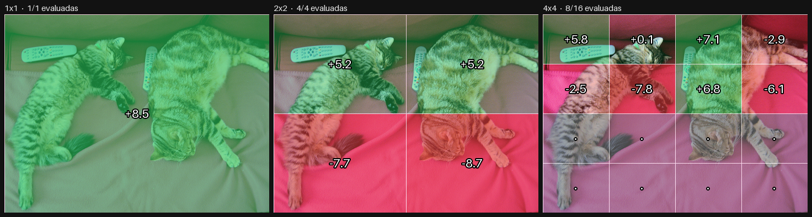
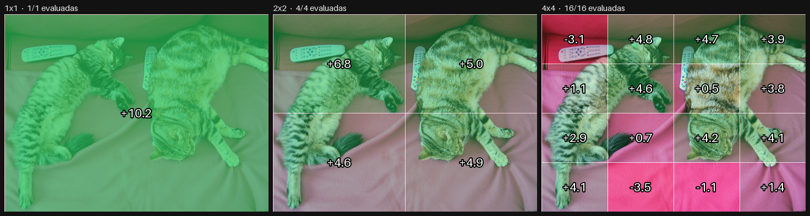
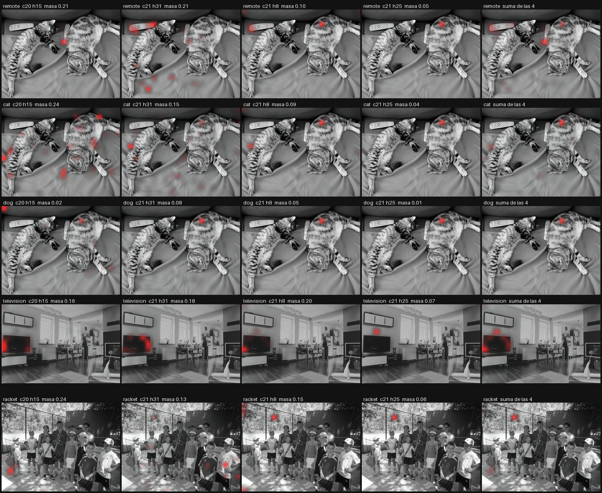

# YOLOJ

A feature pyramid made of questions. No detection head, no label set, nothing
trained.



*"Is any part of a remote control visible?" — 19 forward passes, 7.7 s. Green is
yes, red is no, numbers are the logit gap in nats. Grey cells were never
evaluated: the level above already said no.*

YOLO finds things at several scales with heads trained on a fixed vocabulary.
YOLOJ walks the same pyramid, but each cell is answered by a vision-language
model reading a yes/no predicate out of its logits (JEV / *semantic ifs*, see
[discern](https://github.com/XxSamaxX/discern)). The predicate is free text
declared at run time, so the output is a coarse location map for an **arbitrary**
feature, not for one of 80 classes.

Status: first experiment. It runs and the maps look right on a handful of
images; nothing here is benchmarked yet.

## How it works

1. **Levels.** The whole image, then a 2×2 grid of crops, then 4×4.
2. **One predicate per cell.** The model is asked the question with two lettered
   options and generates a single token. Only the log-probabilities of `A` and
   `B` are read; their difference is the gap.
3. **Top-down pruning.** A cell whose gap is below `--poda` (default −3 nats)
   does not descend: its children inherit the "no" for free.
4. **Order calibration.** The model leans towards letter `A` by about 2.4 nats.
   When the first pass lands under 6 nats, the options are swapped, asked again,
   and the two gaps averaged.

Pruning assumes an existence predicate ("is there a cat"): if it holds in a
child it holds in the parent. Whatever the coarse level is too coarse to see is
lost. `--sin-poda` evaluates every cell so that loss can be measured.

## Run it

It talks to a [llama.cpp](https://github.com/ggml-org/llama.cpp) server with a
vision model, over the OpenAI-compatible API:

```bash
llama-server -m model.gguf --mmproj mmproj.gguf -ngl all

pip install -e .
export YOLOJ_URL=http://127.0.0.1:8080/v1
yoloj photo.jpg "Is any part of a remote control visible?"
```

```
nivel 0 (1x1)
    +8.5
nivel 1 (2x2)
    +5.2   +5.2
    -7.7   -8.7
nivel 2 (4x4)
    +5.8   +0.1   +7.1   -2.9
    -2.5   -7.8   +6.8   -6.1
       ·      ·      ·      ·
       ·      ·      ·      ·
13/21 celdas evaluadas, 19 forwards, 7.7 s
```

It also writes the panel above and a JSON with every cell to `out/`.

```python
from yoloj import piramide

r = piramide("photo.jpg", "Is any part of a cat visible?", niveles=(1, 2, 4))
r.mapa()        # 4x4 list of gaps, the finest level
r.forwards      # what it cost
```

The model must support turning reasoning off through
`chat_template_kwargs: {"enable_thinking": false}`; otherwise the first token is
the start of its thinking, not the letter.

## First numbers

Qwen3.8-27B at 2 bits per weight (IQ2_XXS) on an RTX 3080, 640×480 COCO images,
13 October 2026. Read by eye, with no ground truth yet.

| Predicate | Cells evaluated | Forwards | Time |
|---|---|---|---|
| a cat (two cats fill the frame) | 21 / 21 | 40 | 15.5 s |
| a television | 21 / 21 | 41 | 15.7 s |
| a tennis racket | 17 / 21 | 31 | 11.8 s |
| a remote control | 13 / 21 | 19 | 7.7 s |
| a dog (absent) | 1 / 21 | 1 | 0.7 s |

- A forward costs about 0.7 s on the full image (≈390 prompt tokens) and
  0.37 s on a crop (≈150–170 tokens).
- 2×2 and 4×4 crops cost almost the same, because small crops are upscaled to
  224 px on the short side.
- An absent object costs one forward. A present one costs nearly the full grid,
  because calibration fires on most cells: crop gaps sit under 6 nats.
- A crop that shows only fur, with no outline, scores +0.5 for "cat". Context
  matters to the model more than texture.



## Open questions

- Is the gap comparable across scales, or does each level need its own threshold?
- How often does pruning discard a cell that would have said yes?
- Does cell overlap (`--solape`) fix objects split across a border?
- Is a 27B model needed at the leaves, or does a 4B do once the root has spoken?
- The server re-processes the image when only the question changes, although
  the image comes first in the prompt. Several predicates per crop should be
  nearly free and are not.

## Credits

The prompt contract and the readout come from
[SemIf](https://github.com/TheoLeeCJ/SemIf) by Theo C. J. Lee (MIT), by way of
[discern](https://github.com/XxSamaxX/discern). Example images are from COCO
val2017; the photographs are from Flickr and keep their original licences.

MIT licence.

## Inside the 4B: where the answer is made

`experimentos/desgrane.py` runs Qwen3-VL-4B once per (image, predicate) in
transformers and keeps every layer's attention and hidden state. First pass,
five cases on three COCO images, 13 October 2026. Read by eye; the heads below
were picked on two of the same images they are shown on, so this is a lead, not
a result.

- **The answer appears at layer 24 of 36.** Reading the yes/no gap from each
  layer's hidden state gives noise (+0.5 to +3, always leaning to `A`) up to
  layer 23, then ±7 to ±9 with the right sign at layer 24 in all five cases, and
  ±19 to ±22 at the last layer.
- **The model looks at the image in layers 17 to 23**, just before deciding.
- **A sink token eats the late attention.** From layer 18 on, 65–78 % of the
  attention to the image goes to one patch that does not change with the
  question. Averaging heads shows only that patch.
- **A few heads in layers 20–21 point at the object.** Heads 20.15, 21.31, 21.8
  and 21.25 put 25–51 % of their image attention inside the remote controls
  (6 % of the grid) and 49–76 % inside the television (8 %).
- **Their attention mass drops when the object is absent**: 0.21 / 0.21 for
  "remote", 0.02 / 0.08 for "dog" on the same photo.
- **Attention is nearly free**: 126 ms per forward without it, 123–169 ms with
  every layer's attention returned. 8.3 GiB of VRAM in bf16.



*Rows: remote, cat, dog (absent), television, racket. Columns: the four heads
and their sum. The dot on the cat's back in the right-hand columns is the sink.*
